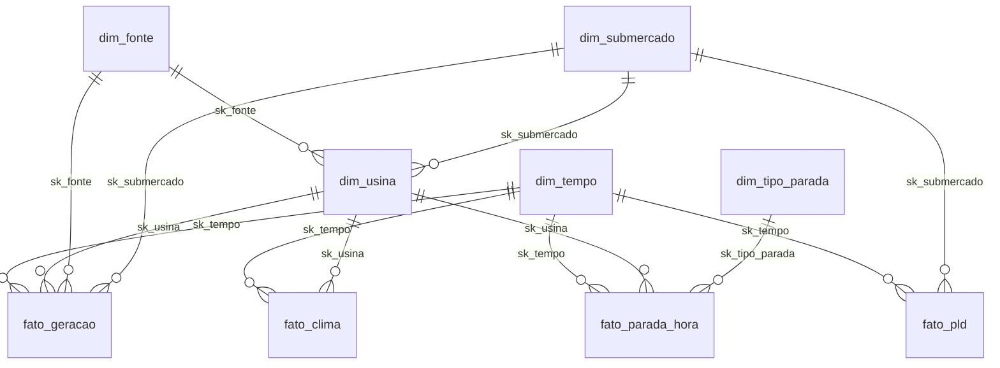

# Documento de modelagem · DW Campo Real Energia

Schema `dw_campo_real` (PostgreSQL). Scripts em `sql/04_dw/`.

## 1. Matriz de barramento

| Processo de negócio | dim_tempo | dim_usina | dim_fonte | dim_submercado | dim_tipo_parada |
|---|:-:|:-:|:-:|:-:|:-:|
| Geração horária | X | X | X | X | |
| PLD horário | X | | | X | |
| Clima no ponto da usina | X | X | (via usina) | (via usina) | |
| Paradas (horas indisponíveis) | X | X | (via usina) | (via usina) | X |

As dimensões são conformadas: `dim_tempo` e `dim_submercado` são as mesmas em geração, preço, clima e paradas. É isso que permite valorar a geração (geração × PLD) juntando os dois fatos por `sk_tempo` e `sk_submercado`.

## 2. Grão de cada fato (declarado antes da criação das tabelas, no DDL)

| Fato | Grão | Medidas |
|---|---|---|
| `fato_geracao` | uma linha por usina (versão vigente) e por hora, só leituras aprovadas na qualidade | energia_mwh, disponibilidade_mw, energia_original_mwh, corrigida, horas_ate_recebimento |
| `fato_pld` | uma linha por submercado e por hora | pld_rs_mwh |
| `fato_clima` | uma linha por usina e por hora, no ponto das coordenadas da usina | temperatura, vento 10 m e 100 m, radiação, chuva |
| `fato_parada_hora` | uma linha por parada, usina e hora dentro da parada | energia e receita estimadas não geradas |

A receita valorada (geração × PLD) não é armazenada: é calculada na view `vw_receita_horaria`, para que o preço sempre venha do `fato_pld`.

## 3. Diagrama (star schema)

## 4. Dimensão de tempo (construída pelo grupo)

Uma linha por hora de 01/01/2025 a 31/12/2026 (17.520 linhas), chave `sk_tempo` = AAAAMMDDHH. Atributos: data, ano, trimestre, mês (número e nome), ano-mês, dia, hora, dia da semana (número e nome), fim de semana, feriado (nome e tipo), **dia útil**, **estação do ano** (hemisfério sul) e **patamar de carga**.

- Dia útil: não é fim de semana e não é feriado do tipo "Feriado". Ponto facultativo (Carnaval, Corpus Christi) continua dia útil, mas fica identificado em `tipo_feriado`.
- Patamar de carga (simplificado pelo grupo, não é a definição oficial do ONS): dia útil: Leve 0–6h e 23h, Média 7–17h e 21–22h, Pesada 18–20h; fim de semana e feriado: Média 18–20h e Leve no resto.
- Feriados: 2025 vêm da tabela de origem; 2026 foram complementados com o calendário nacional (regra de qualidade C08), registrados em `ref_feriado` com a coluna `fonte`.

## 5. Chaves substitutas e membro "desconhecido"

Todas as dimensões têm chave `sk_*` e o membro `-1` ("Desconhecido"). A estratégia para registros sem correspondência é:

- parada com tipo não reconhecido recebe `sk_tipo_parada = -1` (o registro continua útil);
- leitura de geração cuja usina não existe no cadastro (id 99) **não** vai para o membro desconhecido: sem usina não há submercado nem preço, então ela fica na quarentena (`stg.medicao_classificada`, regra R01) e aparece em `qualidade_impacto_tratamento`.

## 6. SCD de `dim_usina`: tipo 2

Se uma usina mudar de nome, potência, situação, fonte ou submercado, o histórico é preservado: a versão vigente é fechada (`vigente_ate`, `atual = false`) e abre-se uma nova com `vigente_de`. A primeira versão tem vigência desde 1900 para cobrir todo o histórico de medição. O fato junta pela vigência (`data_hora >= vigente_de AND data_hora < vigente_ate`).

Justificativa: fator de capacidade depende da potência vigente na época (uma repotenciação não pode alterar o fator de 2025), e valorar geração por fonte ou submercado exige a classificação da época. Atributos de localização e correções de cadastro (UF, coordenadas, município) são SCD tipo 1: correção de erro, não mudança de fato.

A origem não guarda histórico, então hoje cada usina tem uma versão. A lógica de versionamento está em `sql/04_dw/02_carga_dimensoes.sql` e é exercida a cada carga.

## 7. Granularidades diferentes

| Dado | Granularidade | Tratamento |
|---|---|---|
| Geração e PLD | horária | fatos no mesmo grão (hora), ligados por `dim_tempo` |
| Clima Open-Meteo | horária, por coordenada | associado à **usina** (cada usina tem seu ponto), e a usina leva ao submercado |
| Cadastro da usina | cadastral (muda raramente) | dimensão com SCD |
| Feriados | diária | atributo da `dim_tempo` replicado nas 24 horas |
| Paradas | intervalo (início e fim) | explodido em horas (`fato_parada_hora`) |
| Indicadores mensais ou anuais | agregados | calculados no painel, a partir do grão horário |

## 8. Decisões de qualidade aplicadas na carga

A limpeza roda no caminho até o DW (`sql/04_dw/03_limpeza_medicao.sql`), sem alterar a origem. Cada leitura recebe um motivo de quarentena ou passa. As regras e justificativas estão em `qualidade.decisoes`; o impacto está em `dw_campo_real.qualidade_impacto_tratamento` e `qualidade_antes_depois`.

Correções de cadastro (tabela `correcao_cadastro`, com evidência): sinal da latitude da UFV Campo Real Minas e UF da UTE Bagaço Campo Real. De-para de usina duplicada em `ref_depara_usina`.

## 9. Limitações assumidas

- O clima da usina com coordenada corrigida foi baixado com a coordenada errada. Em `fato_clima` ele fica com `ponto_clima_confiavel = false` e fica fora das análises de clima.
- A energia estimada não gerada em paradas usa a média da usina na mesma hora e mês, fora de paradas. Quando o mês inteiro está parado (biomassa em dezembro) não há base e a estimativa fica vazia, sem inventar valor.
- O PLD de 2025 e 2026 foi carregado por CSV porque a API da CCEE respondeu HTTP 403 (evidência em `qualidade.log_execucao`).
